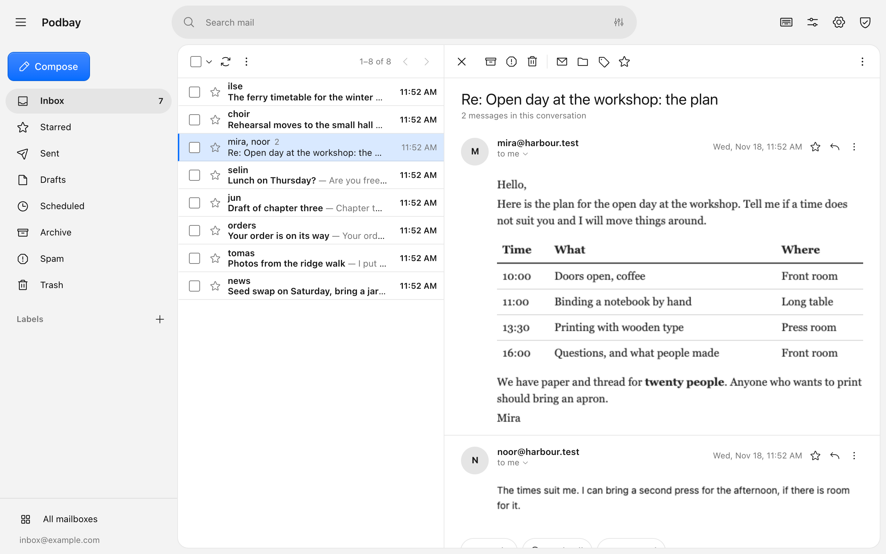
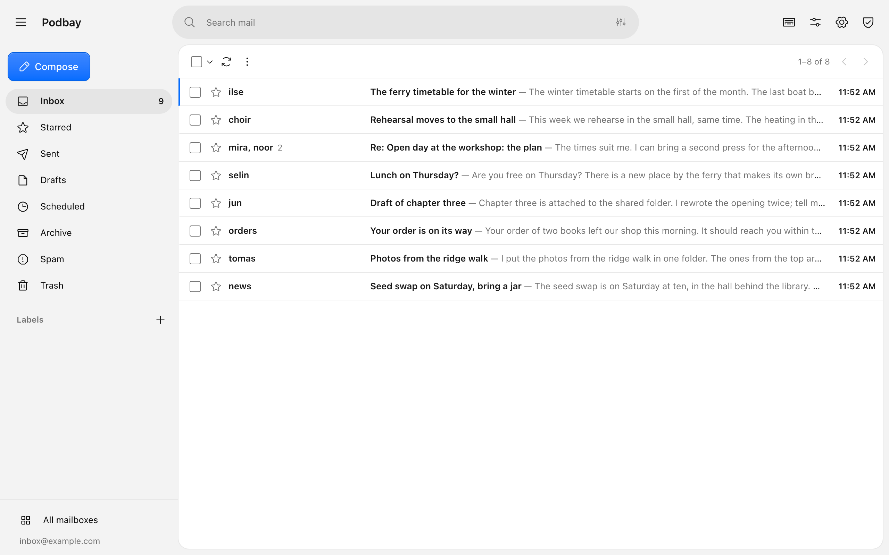
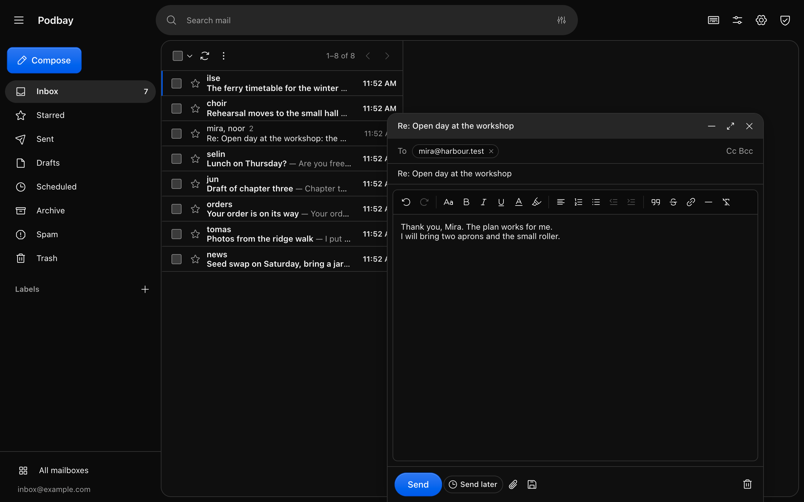

# Podbay

Self-hosted mail that runs entirely in your own Cloudflare account. Email Routing brings mail in, the `send_email` binding sends it out, each mailbox is a Durable Object, and messages and files stay in your account's own storage.

> **Status: early development. Nothing here is ready for real mail.** The project has no release yet, and no full security audit has run. Version 0.1 is gated on one ([security records](docs/security/README.md)).

## What it looks like

A conversation open beside the list. Every message and every person in these pictures is invented.



| The inbox | Writing, in the dark theme |
|---|---|
|  |  |

## What exists today

Everything below is built and tested in this repository. What is missing is in the [roadmap](docs/roadmap.md), and what is knowingly left open is in the [status](docs/status.md), section 3.

- **Accounts and access.** Sign-in with a password, an authenticator app and passkeys; invitations; recovery links; roles for the instance and memberships for each mailbox, checked on every route; an audit log.
- **Reading.** Conversations, places and nested labels, search with operators, a reading pane, keyboard shortcuts. Mail HTML goes through one sanitising renderer into a sandboxed frame, and remote images stay out until the reader asks. The bytes a message arrived as are kept and can be shown or downloaded.
- **Writing.** A formatting bar, recipients completed from the mail the mailbox has sent, drafts that save themselves and keep their files, replies written under their conversation.
- **Sending.** A sent message waits in the mailbox and leaves at its time: Undo for a few seconds after Send, "Send later", and a place that lists what is scheduled. A message that could not be sent comes back to Drafts with the reason.
- **Lists.** One request acts on many conversations, with Undo; Trash and Spam are emptied in one step; open tabs learn of changes within about a second.
- **Languages.** English and Turkish.
- **Optional, off by default.** An assistant on Workers AI that can read and draft but cannot send, and an MCP endpoint with per-mailbox keys.

## Try it locally

No Cloudflare account is needed. Local development uses simulated mail and never sends anything.

```bash
pnpm install
pnpm dev        # http://localhost:5173; then open /setup with the token from .dev.vars
```

You need Node 24 or newer and pnpm 12 (`corepack enable`). To deliver a test message to the local server, see the commands in [`AGENTS.md`](AGENTS.md).

## Tests

```bash
pnpm check          # lint, static checks, typecheck, unit tests, build
pnpm test:workerd   # the handlers in the real Workers runtime, every binding local
pnpm e2e            # the built app in a real browser, on its own throwaway instance
```

None of them needs an account or a secret. Which tier proves what is in the [`podbay-testing`](.claude/skills/podbay-testing/SKILL.md) skill.

## Documents

- [Roadmap](docs/roadmap.md): where the project is going, what is done, what comes next.
- [Status](docs/status.md): which rule is held by which check today, and what is knowingly left open.
- [Architecture](docs/architecture.md): what Podbay is, its components and the installer contract.
- [Feature scope and phases](docs/feature-scope.md): the experience bar, the feature matrix, the design principles.
- [Sign-in and access](docs/auth-and-access.md): accounts, roles, mailbox memberships, credentials for programs.
- [Engineering rules](docs/engineering-rules.md): the version policy, the security rules and the developer rules, each with its automated check.
- [Decisions](docs/adr/README.md): one record for each decision that changes a contract, a stored format or the direction.
- [The repository and its settings](docs/repository.md): which protections are in force and what is done on the day it becomes public.
- [Cloudflare facts](docs/cloudflare/README.md): what the code relies on about the platform, each with its source and the date it was read.

## Contributing

Read [`CONTRIBUTING.md`](CONTRIBUTING.md) before opening a pull request, and [`AGENTS.md`](AGENTS.md) for the layout, the commands and the rules; it is one page for people and coding agents alike. Planned work is in the [issues](https://github.com/cloudhal-dev/podbay/issues). The project's conduct rules are in [`CODE_OF_CONDUCT.md`](CODE_OF_CONDUCT.md), and how it is run is in [`GOVERNANCE.md`](GOVERNANCE.md).

## Security

Do not open a public issue for a vulnerability. [`SECURITY.md`](SECURITY.md) says how to report one privately and what is in scope.

## Home

The project's home is `podbay.cloudhal.dev` ([ADR-0003](docs/adr/0003-project-home-on-cloudhal-dev.md)). Nothing is published there yet.

## Origin

Podbay starts from Cloudflare's [`agentic-inbox`](https://github.com/cloudflare/agentic-inbox) reference app. The files that came from it are listed in [`copies.json`](copies.json); see [`NOTICE`](NOTICE).

## Licence

Apache-2.0. See [`LICENSE`](LICENSE).
